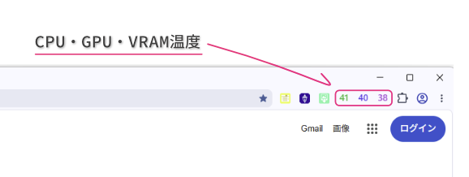

# TempGlyph

**CPU / GPU / VRAM temperatures in your Chromium-based browser toolbar.**  
Chromium系ブラウザのツールバーに、CPU・GPU・VRAMの温度を表示するWindows向けユーティリティです。



## ダウンロード / Download

[**GitHub Releases**](../../releases) から **`TempGlyph_v0.1.4_PUBLIC_FINAL.zip`** をダウンロードしてください。ZIP全体に、インストーラー・説明書・第三者ライセンス資料が含まれています。

Download **`TempGlyph_v0.1.4_PUBLIC_FINAL.zip`** from [GitHub Releases](../../releases). Distribute and retain the complete archive, including third-party license and source information.

## 主な機能 / Features

- CPU・GPU・VRAMの温度をブラウザのツールバーに表示 / Display CPU, GPU, and VRAM temperatures in the browser toolbar
- 必要に応じてWorkerを起動し、未使用時は自動終了 / On-demand background worker with automatic idle shutdown
- Windows向けのインストーラー・アンインストーラー / Windows installer and uninstaller

## インストール / Installation

1. 配布ZIPをすべて展開し、`TempGlyph_v0.1.4_Setup.exe` を実行します。管理者権限が必要です。  
   Extract the release ZIP, then run `TempGlyph_v0.1.4_Setup.exe` (administrator approval required).
2. インストール後、使用するChromium系ブラウザで `chrome://extensions` を開き、**デベロッパーモード**を有効にします。  
   Open `chrome://extensions` in your browser and enable **Developer mode**.
3. **「パッケージ化されていない拡張機能を読み込む」 / “Load unpacked”** で以下の4フォルダを**それぞれ**読み込みます。  
   Load each of these four folders individually:

   ```text
   C:\Program Files\TempGlyph\Browser\Hub
   C:\Program Files\TempGlyph\Browser\Extensions\Slot_1_CPU
   C:\Program Files\TempGlyph\Browser\Extensions\Slot_2_GPU
   C:\Program Files\TempGlyph\Browser\Extensions\Slot_3_VRAM
   ```
4. **HubをON**にしてからCPU・GPU・VRAM拡張をONにします。利用可能なセンサーが検出されると温度が表示されます。  
   Enable **Hub first**, then enable the CPU, GPU, and VRAM display extensions. Temperatures appear when supported sensors are available.

> **重要 / Important:** Setup.exeだけではブラウザ拡張は自動登録されません。拡張機能は上記手順で手動導入してください。  
> The installer does **not** automatically install the browser extensions.

## 対応環境・制限 / Compatibility and limitations

- 対象は64-bit Windows 10/11およびChromium系ブラウザです。主に開発者環境で実機検証しており、すべての構成での動作を保証するものではありません。  
  Intended for 64-bit Windows 10/11 and Chromium-based browsers. Testing has primarily been performed on the developer's system; hardware compatibility varies.
- Slot 4～6は将来の拡張用で、v0.1.4ではセンサー値を提供しません。 / Slots 4–6 are placeholders and do not supply sensor values in v0.1.4.
- 複数GPU環境でのGPU指定は未対応です。 / Selecting a specific GPU in multi-GPU systems is not supported.
- 旧版からの上書きアップデートや設定の自動移行には対応していません。旧版の表示拡張はOFFにしてください。 / In-place upgrades and automatic migration of old settings are not supported. Disable older display extensions before use.
- インストール時に管理者権限が必要で、Workerも管理者権限で動作します。別管理者アカウントでUAC認証する構成や共有PCは未検証です。 / Installation and the worker require elevated permissions. Separate-administrator UAC and multi-user PC scenarios are untested.
- インストーラーはコード署名されていません。 / The installer is not code-signed.

## アンインストール / Uninstall

TempGlyphのブラウザ拡張をOFFにし、ブラウザを完全終了します。約45秒待った後、Windowsの**設定 → インストールされているアプリ → TempGlyph**からアンインストールしてください。

Disable the TempGlyph browser extensions, fully close the browser, wait approximately 45 seconds, then uninstall **TempGlyph** from Windows **Installed apps**.

## 第三者ライブラリ / Third-party components

配布ZIPの `ThirdPartyLicenses` と `ThirdPartySources` に、同梱ライブラリのライセンス・ソース情報を収録しています。  
Third-party license notices and source information are included in the release archive under `ThirdPartyLicenses` and `ThirdPartySources`.

---

**Version:** 0.1.4
