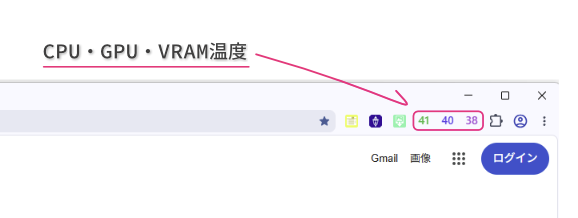

# TempGlyph

**CPU / GPU / VRAM temperatures in your Chromium-based browser toolbar.**  
Chromium系ブラウザのツールバーに、CPU・GPU・VRAMの温度を表示するWindows向けユーティリティです。



## ダウンロード / Download

[**GitHub Releases**](../../releases) から **`TempGlyph_v0.1.5_Release.zip`** をダウンロードしてください。ZIP全体に、インストーラー・説明書・第三者ライセンス資料が含まれています。

Download **`TempGlyph_v0.1.5_Release.zip`** from [GitHub Releases](../../releases). Distribute and retain the complete archive, including third-party license and source information.

## 主な機能 / Features

- CPU・GPU・VRAMの温度をブラウザのツールバーに表示 / Display CPU, GPU, and VRAM temperatures in the browser toolbar
- 約1秒間隔で温度を更新 / Approximately one-second temperature updates
- 必要に応じたWorkerの起動と未使用時の自動終了 / On-demand background worker with automatic idle shutdown
- Windowsインストーラー・アンインストーラー / Windows installer and uninstaller

## v0.1.5での変更 / What's new in v0.1.5

- WorkerとNativeHostの通信を、毎秒更新する`JSON`ファイルから名前付きパイプ（IPC）へ変更 / Replaced per-second JSON-file transport with named-pipe IPC
- `sensors.json`と`.ping`への定期書き込みを廃止 / Removed recurring writes to `sensors.json` and `.ping`
- ファイル置換に失敗すると`.tmp`ファイルが残る原因となっていた定期処理を廃止（既存ファイルは削除しません） / Removed the recurring file-replacement path that could leave `.tmp` files; existing files are not automatically deleted
- FanControlプラグインやファン制御設定の変更は不要 / No changes to FanControl plugins or fan settings are required

## インストール / Installation

1. **以前のTempGlyphがインストールされている場合、ブラウザを完全終了し、約40秒待ってからWindowsの「インストールされているアプリ」で通常アンインストールしてください。上書き更新には対応していません。**  
   **In-place upgrades are not supported.** Close the browser, wait approximately 40 seconds, then uninstall the previous version through Windows Installed apps.
2. 配布ZIPをすべて展開し、`TempGlyph_v0.1.5_Setup.exe`を管理者として実行してください。  
   Extract the whole ZIP and run `TempGlyph_v0.1.5_Setup.exe` as administrator.
3. インストール後、Chromium系ブラウザで`chrome://extensions`を開き、デベロッパーモードを有効にしてください。  
   Open `chrome://extensions` and enable Developer mode.
4. 「パッケージ化されていない拡張機能を読み込む」から、以下の**4つのフォルダをそれぞれ個別に**登録してください。既存の登録が残っている場合は重複登録せず、必要に応じて再読み込みしてください。  
   Use **Load unpacked** to load all four folders individually. If the same extensions remain registered, reload instead of creating duplicates.

   ```text
   C:\Program Files\TempGlyph\Browser\Hub
   C:\Program Files\TempGlyph\Browser\Extensions\Slot_1_CPU
   C:\Program Files\TempGlyph\Browser\Extensions\Slot_2_GPU
   C:\Program Files\TempGlyph\Browser\Extensions\Slot_3_VRAM
   ```

5. Hubと各表示拡張を有効にしてください。利用可能なセンサーが検出されると温度が表示されます。  
   Enable the Hub and display extensions. Temperatures appear when compatible sensors are available.

**重要 / Important:** Setup.exeだけではブラウザ拡張は自動登録されません。 / The installer does not register the browser extensions automatically.

## 対応環境・制限 / Compatibility and limitations

- 64-bit Windows 10/11、およびChromium系ブラウザ向け / Designed for Windows 10/11 x64 and Chromium-based browsers
- Slot 4～6は予備であり、v0.1.5の温度表示には使用しません / Slots 4–6 are reserved
- 複数GPU環境でのGPU指定は未対応 / Selecting a specific GPU in multi-GPU systems is not supported
- インストーラーは未署名で、SmartScreenの警告が出る場合があります / Installer is not code-signed and may trigger SmartScreen warnings
- Workerは管理者権限で動作します。複数ユーザーや別管理者アカウントのUAC構成は未検証です / Worker requires elevation; multi-user and separate-administrator UAC scenarios are untested
- Windows 11とHeliumブラウザの一環境でインストール、温度表示、定期書き込み抑制、通常アンインストールを確認済み。全環境での動作保証ではありません / Verified on one Windows 11 / Helium system; other configurations are not comprehensively tested

## アンインストール / Uninstall

ブラウザを完全終了し、約40秒待ってからWindowsの「インストールされているアプリ」でTempGlyphを通常アンインストールしてください。ProgramDataやタスクを手動で強制削除しないでください。  
Fully close the browser, wait approximately 40 seconds, then uninstall TempGlyph via Windows Installed apps. Do not force-delete ProgramData contents or scheduled tasks manually.

## 第三者ライブラリ / Third-party components

配布ZIPの`ThirdPartyLicenses`と`ThirdPartySources`に、第三者ライブラリのライセンス通知・ソース関連資料を収録しています。Mono.Posix.NETStandard 1.0.0の当時のパッケージ固有の原文については、同梱の注意書きに記載のとおり、完全な照合を完了していません。  
Third-party notices and source references are included under `ThirdPartyLicenses` and `ThirdPartySources`. The exact vintage package-specific licensing text for Mono.Posix.NETStandard 1.0.0 has not been fully authenticated, as disclosed in the bundled notes.

---

Version: **0.1.5**
